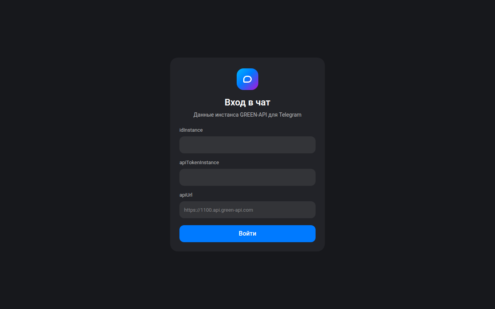
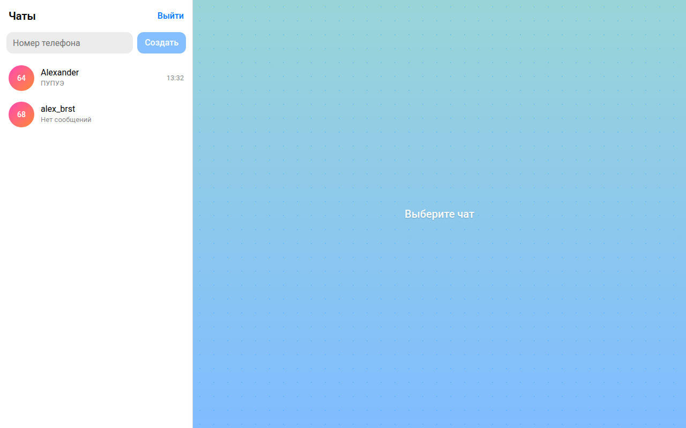
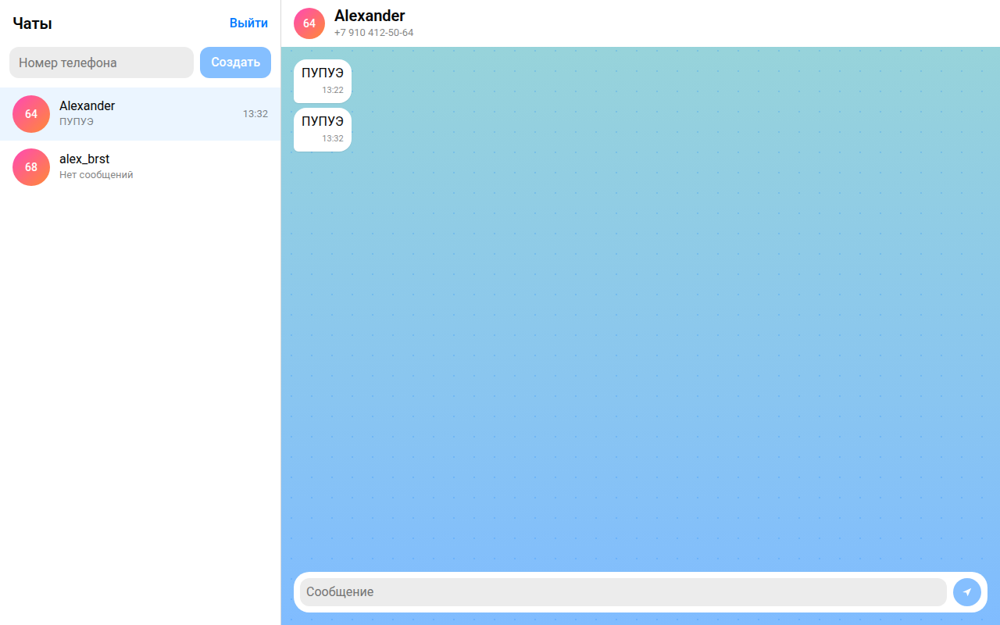

# Скрины

## Вход

Сюда вводишь `idInstance`, `apiTokenInstance` и `apiUrl`. Токен на экране скрыт, адрес подставляется по первым цифрам id.

## Чаты

Номер телефона, кнопка «Создать» и список диалогов. Пока чат не выбран, справа пустое поле.

## Переписка

Открытый диалог. Ответ из Telegram приходит в этот чат, снизу поле для своего сообщения.

